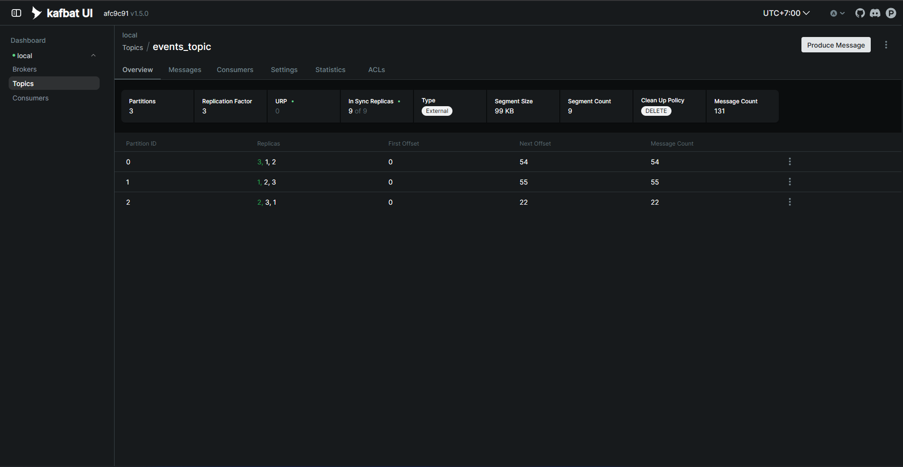
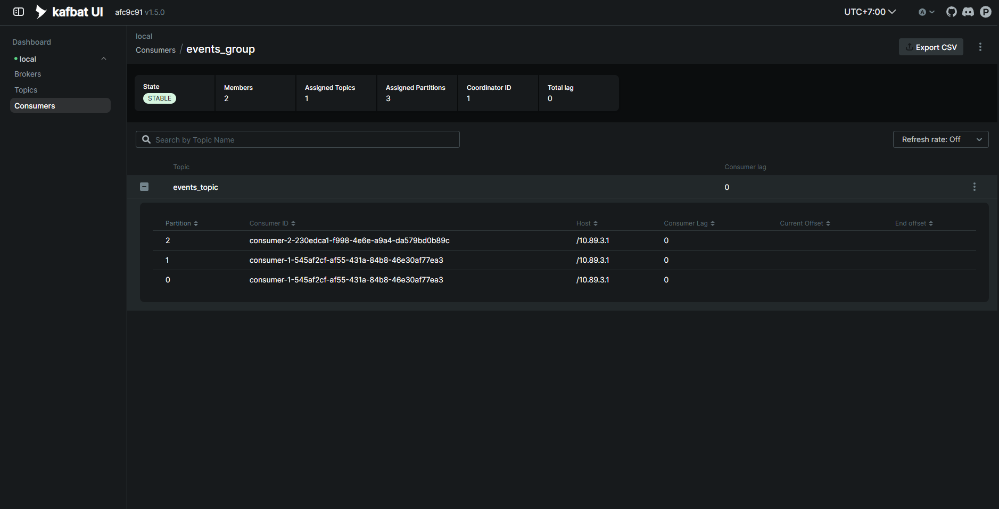
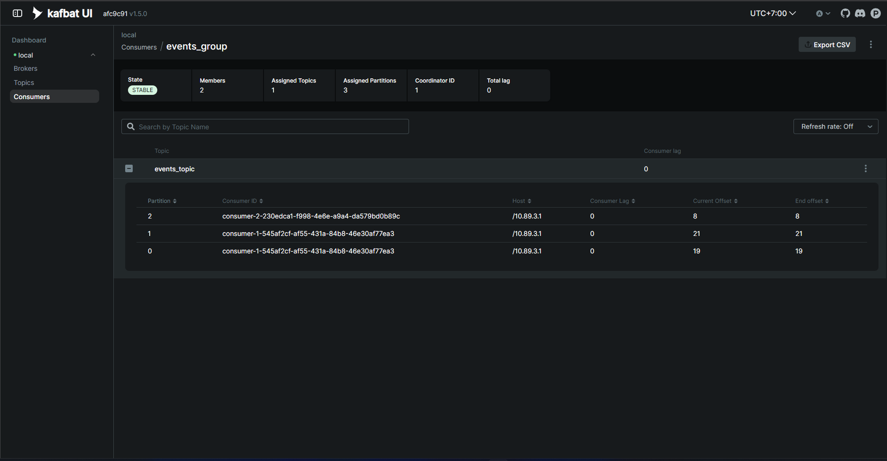

# Report — Kafka Key-Based Partitioning & Consumer Group

**Pipeline:** `Producer (Faker, 1 event/5 detik, key = user_N)` → `events_topic (3 partition, RF 3)` → `Consumer group events_group (2 consumer)` → `SQLite output/events.db`

**Lingkungan:** Docker Compose, Kafka 3 broker mode KRaft (tanpa Zookeeper), Kafbat UI, Python 3 + `confluent-kafka`. Semua waktu di bawah adalah waktu lokal komputer (UTC+7).

---

## 1. Struktur Project & Bukti

```
kafka-assignment/
├── docker-compose.yml      # 3 broker KRaft, kafka-init (buat topic), Kafbat UI
├── requirements.txt
├── .env.example            # template konfigurasi (.env = salinan lokal)
├── README.md
├── report.md               # file ini
├── src/
│   ├── config.py           # konfigurasi dari .env + logging
│   ├── producer.py         # producer key-based, murmur2_random
│   ├── consumer.py         # consumer + agregasi per user + commit manual
│   ├── storage.py          # sink SQLite (PK = partition + offset)
│   └── stats.py            # query bukti distribusi
├── output/
│   └── events.db           # data sink (bukti end-to-end)
├── evidence/
│   ├── producer.log
│   ├── consumer-1.log
│   ├── consumer-2.log
│   └── stats.txt
└── screenshot/
    ├── 01-consumers-2-member.png
    ├── 02-partition-lag.png
    └── 03-replication.png
```

| Kebutuhan assignment | Bukti |
|---|---|
| Kafka cluster via Docker (broker, UI, partition, replication) | `docker-compose.yml`, `screenshot/03-replication.png` (Kafbat UI) |
| Producer berkala + key-based partitioning | `src/producer.py`, `evidence/producer.log` |
| Consumer + agregasi + sink | `src/consumer.py`, `output/events.db`, `evidence/stats.txt` |
| ≥ 2 consumer dalam 1 group | `evidence/consumer-1.log`, `evidence/consumer-2.log`, `screenshot/` |
| Clean code (logging, try/except, PEP8) | `src/*.py` |

---

## 2. Bagaimana Kafka Menentukan Partition dari Key

Partition dihitung oleh **producer** sebelum event dikirim; broker tidak ikut memilih. Untuk record yang punya key, rumusnya (default partitioner Java client, dan `murmur2_random` di librdkafka yang dipakai kode ini):

```
partition = (murmur2(key_bytes) & 0x7fffffff) % jumlah_partition
```

- `murmur2` adalah fungsi hash non-kriptografis yang **deterministik**: key yang sama selalu menghasilkan hash yang sama.
- `& 0x7fffffff` membuang sign bit supaya hasilnya tidak negatif.
- `% jumlah_partition` memetakan hash ke rentang `0 … N-1`.

> Default librdkafka (`consistent_random`) memakai CRC32, bukan murmur2. Producer di project ini memakai `"partitioner": "murmur2_random"` secara eksplisit supaya sama dengan rumus di atas.

**Konsekuensi:**

- Key sama → partition sama → **urutan event per key terjaga** (ordering hanya dijamin di dalam satu partition).
- Key berbeda bisa jatuh ke partition yang sama (collision), sehingga distribusi tidak dijamin merata.
- Mengubah jumlah partition pada topic yang sudah berisi data mengubah hasil `% N`, sehingga key bisa pindah partition.

**Hasil hitungan untuk topic ini (3 partition):**

| key | murmur2 | partition (hitungan) | partition (observasi `producer.log`) |
|---|---:|---:|---:|
| user_1 | 2109805095 | 0 | 0 |
| user_2 | 1279321690 | 1 | 1 |
| user_3 | 3643963238 | 0 | 0 |
| user_4 | 3079261990 | 2 | 2 |
| user_5 | 1021273357 | 1 | 1 |

Dari 131 event di `producer.log`, setiap key hanya pernah dikirim ke satu partition, dan semuanya cocok dengan hasil hitungan. Output `stats.py` (bagian "Key → partition") menunjukkan hal yang sama dari sisi sink:

```
('user_1', 0, 29)   ('user_2', 1, 27)   ('user_3', 0, 25)
('user_4', 2, 22)   ('user_5', 1, 28)
```

Jumlah event per partition: partition 0 = 29 + 25 = **54**, partition 1 = 27 + 28 = **55**, partition 2 = **22**. Distribusi tidak merata karena partition 2 hanya menampung satu key (`user_4`), sementara partition 0 dan 1 masing-masing menampung dua key.

---

## 3. Replication & Konfigurasi Cluster

Topic `events_topic` dibuat oleh service `kafka-init` di `docker-compose.yml` dengan `--partitions 3 --replication-factor 3` pada cluster 3 broker. Tampilan Kafbat UI (Topics → `events_topic` → Overview) setelah eksperimen:



| Partition | Replicas (leader = yang pertama) | Leader | Message count |
|---:|---|---:|---:|
| 0 | 3, 1, 2 | broker 3 | 54 |
| 1 | 1, 2, 3 | broker 1 | 55 |
| 2 | 2, 3, 1 | broker 2 | 22 |

**Observasi:**

- **Replication factor 3:** tiap partition punya 3 replica, satu di setiap broker. Satu replica berperan sebagai leader (melayani baca/tulis), dua lainnya follower yang menyalin data dari leader.
- **Semua replica sinkron:** `In Sync Replicas = 9 of 9` (3 partition × 3 replica) dan `URP = 0` (tidak ada under-replicated partition).
- **Leader tersebar:** leader tiap partition berada di broker berbeda (3, 1, 2), sehingga beban tulis dan baca tidak menumpuk di satu broker.
- **Jumlah data konsisten:** `Message Count` 54 + 55 + 22 = **131**, sama dengan jumlah event di producer, consumer, dan SQLite. `Next Offset` per partition (54, 55, 22) juga cocok dengan offset terakhir di log (53, 54, 21) ditambah satu.
- **Pengaturan durabilitas:** producer memakai `acks=all` dan `enable.idempotence=True`, sementara broker memakai `min.insync.replicas=2` (lihat `docker-compose.yml`). Event baru dianggap berhasil setelah diakui seluruh replica yang in-sync, dan broker menolak penulisan bila ISR kurang dari 2.

---

## 4. Observasi Consumer Group (`events_group`)

**Setup:** topic `events_topic` (3 partition, RF 3), 1 producer, 2 consumer (`consumer-1`, `consumer-2`) dalam group `events_group`. Offset di-commit manual setelah data berhasil ditulis ke SQLite.

### 4.1 Timeline (dari log)

| Waktu | Kejadian |
|---|---|
| 12:38:51 | `consumer-1` sendirian: `ASSIGNED [0, 1, 2]` (memegang semua partition). |
| 12:39:31 | `consumer-2` start. |
| 12:39:33 | **Rebalance (consumer join).** `consumer-1`: `REVOKED [0, 1, 2]` lalu `ASSIGNED [0, 1]`. `consumer-2`: `ASSIGNED [2]`. Dua consumer, tiga partition: dibagi 2 : 1. |
| 12:49:51 | Producer dijalankan, event mulai mengalir. Rebalance sudah selesai 10 menit sebelumnya, jadi pembagian partition ditentukan oleh jumlah consumer, bukan oleh data. |
| 12:59:08 | **`consumer-2` dihentikan (Ctrl+C).** `REVOKED [2]`. Offset terakhir yang diproses: 17. |
| 12:59:11 | **Rebalance (consumer leave).** `consumer-1`: `REVOKED [0, 1]` lalu `ASSIGNED [0, 1, 2]` (jeda ±2,35 detik setelah `consumer-2` keluar). |
| 12:59:52 | `consumer-1` memproses partition 2 dari **offset 18**, tepat setelah offset terakhir `consumer-2` (17). |
| 13:00:50 | Producer dihentikan. Event terakhir: partition 1, offset 54. |
| 13:01:44 | `consumer-1` dihentikan setelah semua event terbaca. |

### 4.2 Bukti Kafka UI

Dua consumer aktif, group `STABLE`, 3 partition teralokasi, total lag 0. Partition 2 dibaca `consumer-2`; partition 0 dan 1 dibaca `consumer-1`:



Saat producer berjalan, `Current Offset` sama dengan `End offset` di semua partition (P0 = 19, P1 = 21, P2 = 8), artinya lag 0 — consumer menyusul producer secara real-time:



### 4.3 Pembagian data (`stats.py`)

| Consumer | Partition | Jumlah event |
|---|---:|---:|
| consumer-1 | 0 | 54 |
| consumer-1 | 1 | 55 |
| consumer-1 | 2 | 4 (offset 18–21, setelah `consumer-2` berhenti) |
| consumer-2 | 2 | 18 (offset 0–17) |
| **Total** | | **131** |

Total: `consumer-1` = 113 event (86,3%), `consumer-2` = 18 event (13,7%).

### 4.4 Verifikasi tidak ada data hilang atau ganda

Log producer dan consumer dicocokkan per pasangan `(partition, offset)`:

- Producer mengirim **131** event; consumer memproses **131** event; himpunan `(partition, offset)` keduanya **identik**.
- Tidak ada pasangan `(partition, offset)` yang diproses dua kali.
- Offset tiap partition berurutan tanpa celah: P0 = 0–53, P1 = 0–54, P2 = 0–21.
- Key tiap event di sisi consumer sama dengan key di sisi producer.
- Agregasi di SQLite (131 baris) sama dengan jumlah event di log.

Agregasi per user dari sink:

| user | event | total amount |
|---|---:|---:|
| user_1 | 29 | 8662.78 |
| user_2 | 27 | 7510.09 |
| user_3 | 25 | 6748.40 |
| user_4 | 22 | 7018.37 |
| user_5 | 28 | 6747.86 |

### 4.5 Insight

1. **Pembagian per partition, bukan per event.** Dalam satu group, satu partition hanya dibaca satu consumer pada satu waktu. Dengan 3 partition dan 2 consumer, hasilnya 2 : 1. Consumer tidak "berbagi" event dari partition yang sama.
2. **Beban tidak merata.** `consumer-2` hanya memegang partition 2 yang hanya berisi key `user_4`, sehingga memproses 13,7% event. Ketimpangan ini berasal dari hash key, bukan dari consumer.
3. **Rebalance terjadi saat consumer join dan leave.** Keduanya terlihat jelas di log (`REVOKED` lalu `ASSIGNED`). Jeda ±2,4 detik (join) dan ±2,35 detik (leave) wajar: consumer yang tersisa mengetahui adanya rebalance lewat heartbeat berikutnya ke coordinator.
4. **Failover tanpa kehilangan atau duplikasi data.** `consumer-1` melanjutkan partition 2 dari offset 18, tepat setelah offset 17 milik `consumer-2`. Ini hasil dari commit manual setelah data tersimpan di SQLite: offset yang ter-commit menjadi titik lanjut consumer pengganti.
5. **Rebalance bersifat eager.** Saat `consumer-2` keluar, `consumer-1` melepas partition 0 dan 1 yang sebenarnya tidak berpindah (`REVOKED [0, 1]`), lalu langsung mendapatkannya lagi bersama partition 2. Selama jeda itu pembacaan berhenti untuk semua partition. Strategi `cooperative-sticky` menghindari ini.
6. **State lokal tidak ikut pindah.** Counter per user disimpan di memori tiap proses. Di `consumer-1`, `user_4` tercatat 1–4 padahal total sebenarnya 22 (18 dihitung `consumer-2`). Agregasi yang benar ada di sink SQLite, bukan di counter memori.
7. **Batas paralelisme.** Dengan 3 partition, paling banyak 3 consumer aktif dalam satu group; consumer ke-4 akan idle.

---

## 5. Keterbatasan Eksperimen

- **Jendela failover tidak berisi event tertunda.** Tidak ada event partition 2 yang dikirim antara 12:58:42 (offset 17) dan 12:59:52 (offset 18), jadi eksperimen ini membuktikan kontinuitas offset, bukan penanganan backlog saat failover.
- **`consumer-2` dihentikan dengan Ctrl+C (graceful).** Consumer menutup koneksi dengan benar dan meninggalkan group. Skenario consumer mati mendadak (kill proses) tidak diuji; rebalance pada kasus itu baru terjadi setelah `session.timeout.ms` lewat.
- **Kegagalan broker tidak diuji.** Screenshot replication menunjukkan kondisi sehat (ISR 9 dari 9). Perilaku saat satu broker dimatikan (pemilihan leader baru, ISR menyusut) hanya konsekuensi konfigurasi RF 3 dan `min.insync.replicas=2`, bukan hasil pengamatan.
- **Satu kali run.** Hasil distribusi (86 : 14) berasal dari satu eksekusi dengan 5 key acak; proporsinya akan berbeda pada run lain, tetapi pemetaan key → partition selalu sama.
- **Peringatan `GETPID ... Coordinator load in progress`** di awal `producer.log` bersifat sementara: producer idempotent menunggu coordinator cluster yang baru menyala, lalu retry otomatis. Event pertama tetap terkirim (12:49:51).
